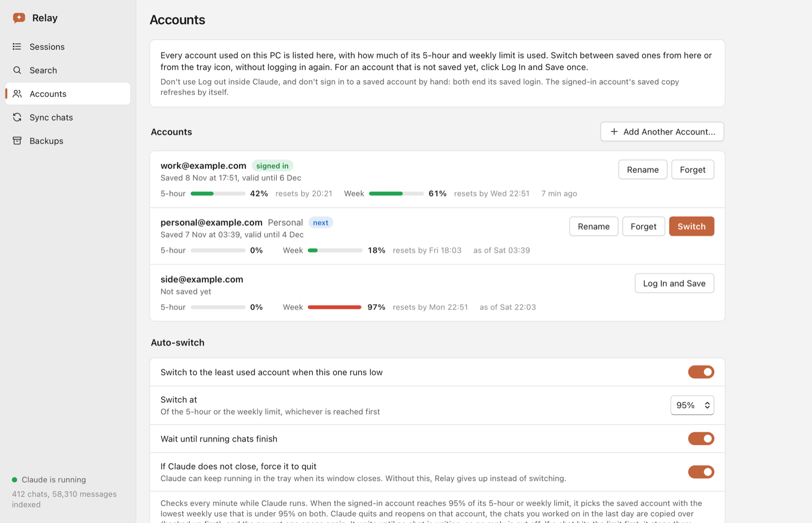
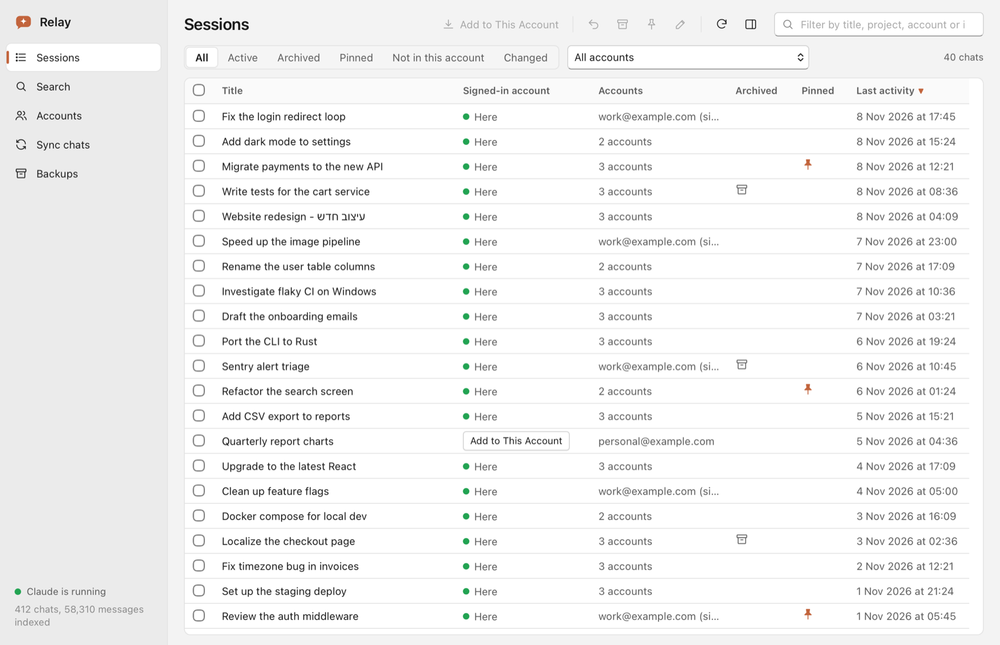

<p align="center">
  
</p>

<h1 align="center">Relay</h1>

<p align="center">
  <b>Several Claude accounts, one computer.</b><br>
  Switch the Claude desktop app between accounts in one click, see how much of each account's limits is left,<br>
  and keep your Code chats with you wherever you are signed in.
</p>

<p align="center">
  <a href="https://github.com/ShiNxz/Relay/releases/latest"></a>
  
  
  <a href="LICENSE"></a>
</p>

<p align="center">
  <a href="https://github.com/ShiNxz/Relay/releases/latest"><b>Download for macOS</b></a>
  &nbsp;&middot;&nbsp;
  <a href="https://github.com/ShiNxz/Relay/releases/latest"><b>Download for Windows</b></a>
</p>

<p align="center">
  
</p>

> Relay is an unofficial community tool. It is not made, endorsed or supported by Anthropic. "Claude" is a trademark of Anthropic.

## Why

If you have more than one Claude plan, say work and personal, or a second account for when the first runs out, the Claude app makes you log out and back in to change accounts. Each account keeps its own list of Code chats, so the chat you started on one is missing on the next. And you can't see which account has room left until you are in it.

Relay sits next to Claude in the menu bar (macOS) or the tray (Windows) and fixes all three.

## What it does

| | |
| --- | --- |
| **Usage at a glance** | Each account's 5-hour and weekly usage, with when it resets, right in the account list and the menu. |
| **One-click switching** | Log in to each account once. After that Relay swaps Claude's login for you, no login screen. |
| **Auto-switch** | When an account reaches your threshold (95% by default), Relay waits for running chats to finish, moves to the least used account and brings your recent chats along. Off until you turn it on. |
| **Chats that follow you** | One list of every Code chat across accounts. A chat only another account has gets **Add to This Account**, so Claude can open it. Or keep accounts in sync. |
| **Search old chats** | Full-text search across all your Claude Code transcripts, kept up to date in the background. |
| **Safe by design** | Every change is previewed, Claude is closed while it happens, and a backup is made first. No network, no telemetry. |

## Get started

1. **Install.** Download from [Releases](https://github.com/ShiNxz/Relay/releases/latest).
   - **macOS** (14 Sonoma or newer): open `Relay-<version>.dmg` and drag Relay to Applications. The build is not notarized yet, so the first time macOS refuses to open it: click **Done**, then **System Settings > Privacy & Security > Open Anyway**. Or run `xattr -dr com.apple.quarantine /Applications/Relay.app`.
   - **Windows** (10 or 11): run `Relay-<version>-windows-x64-setup.exe`. It installs for your user only. The installer is not code signed, so SmartScreen may warn: click **More info > Run anyway**.
2. **Save your accounts.** Open **Accounts**. Click **Save** on the account Claude is signed in to, then **Log In and Save** on each other account and log in to it in Claude. Relay saves it by itself within a minute.
3. **Switch** from the menu bar or tray icon, or with **Switch** in Accounts. Optionally turn on **Auto-switch** there.

Two things end a saved login, because Claude ends that session on the server: **Log out** inside Claude, and signing in to a saved account again by hand. So switch only with Relay. It keeps the signed-in account's saved copy fresh by itself.

<p align="center">
  
</p>

## How it works

<details>
<summary><b>Usage numbers</b>: where they come from and how fresh they are</summary>

The Claude app keeps its own record of plan usage in `plan-usage-history.json` in its folder: the percent used of the 5-hour and the weekly limit, taken about every 30 minutes while Claude runs. Relay reads that file. A record names an organization, not an account, so Relay matches each one to the account that was signed in when it was taken, using Claude's sign-in lines in its log, Relay's own note of which account it switched to, and the times of its login backups.

- **The signed-in account** is at most about 30 minutes behind.
- **Other accounts** show their last figure from when they were signed in. A limit counts as reset once its window has surely passed: the 5-hour limit five hours after its window started, the weekly limit a week after the reading, or earlier when Relay saw that account's weekly figure reset before (weekly limits reset at the same time each week).
- **Reset times** read "resets by": the limit resets at or before that time.
- An account that has never been signed in while Claude was running has no usage yet.

Relay never asks Anthropic's servers for usage. That would need your login tokens, and Relay never decrypts or sends them.
</details>

<details>
<summary><b>Switching</b>: what is swapped, and what happens if Claude says no</summary>

Claude keeps its login in two places: a `Cookies` database and three keys in `config.json`. Relay copies them into its own folder when it saves an account and copies them back when it switches, with Claude closed, after backing up the current ones. They stay encrypted with Claude's own key, and Relay never decrypts them.

After a switch Relay reads Claude's log. If Claude rejects the saved login, Relay puts the previous account back and marks the rejected one **Log In Again**, which reopens Claude signed out (nothing is logged out) so you can log in once more.

**Add Another Account** is for an account that has never been used on this computer.
</details>

<details>
<summary><b>Auto-switch</b>: when it moves, where to, and what it can't do</summary>

Every minute while Claude runs, Relay checks the signed-in account's usage, using only a reading taken since that account signed in. When its 5-hour or weekly use is at the threshold:

1. It picks the saved account with the lowest weekly use that is under the threshold on both limits. Accounts without usage data are tried last. **Accounts** marks this account **next**.
2. With **Wait until running chats finish** on (the default), it waits until no chat of the signed-in account is mid-turn: an unanswered prompt, a tool result Claude has not replied to, or a tool call still running. A chat stuck mid-turn for over 30 minutes does not hold the switch.
3. It quits Claude, copies the chats you worked on in the last 24 hours into the new account (backed up first), swaps the login, reopens Claude, checks that Claude accepted it, and opens the newest of those chats again.
4. A notification says where it went and why.

After an automatic switch it waits 10 minutes before trying again. If every other account is over the threshold too, it stays and tells you, at most every three hours.

It cannot send "continue" for you: Claude gives other apps no way to send a message, and Relay does not use Accessibility to type into Claude. A chat that hit the limit before the switch stays stopped until you send "continue" in it.
</details>

<details>
<summary><b>Chats across accounts</b>: Sessions, Add to This Account, Sync chats</summary>

Claude only opens chats of the account it is signed in to. The transcripts live in `~/.claude/projects` and are shared by every account, but each account has its own list of sidebar entries, so the same chat can appear in several accounts.

**Sessions** shows each chat once. **Accounts** says how many accounts have it (hover to see which), and a green dot marks chats the signed-in account has. **Add to This Account** copies a chat's sidebar entry in, after a preview, with Claude closed and a backup first. Double-clicking such a chat, or opening it from Search, does the same and then opens it. Archive, pin and rename apply to every account's copy; pick one account in the **Folder** menu to change only its copy.

**Sync chats** gives accounts the same chats:

- **Merge:** every picked account ends up with every chat. The newest copy of a chat wins, and a chat deleted in one account stays deleted in all of them.
- **Copy from one account to the others:** only adds and updates chats in the others, never deletes, and never writes to the account it copies from.

Turn on the merge option in Accounts to merge the picked accounts on every switch.
</details>

<details>
<summary><b>Search</b>: what is indexed</summary>

User and assistant text from the main transcripts, kept in a local SQLite FTS5 index that only reads what was added since last time and updates every 10 minutes. Options add tool calls and output, and subagent and workflow transcripts (much larger index). Every word must match, the last word also matches as a prefix, and `"quoted text"` is a phrase. A result opens the chat in Claude, preferring the signed-in account.
</details>

## Privacy and safety

- **No network.** Relay makes no network requests and has no analytics. Opening a chat hands a `claude://` link to Claude, which is the only thing that leaves Relay.
- **Your logins stay encrypted.** Relay copies Claude's login data as it is. It never decrypts it, never reads the Keychain or Windows credential store, and never shows, logs or sends it. Saved logins only work on the computer they were saved on.
- **Preview, backup, then write.** Every change is listed before it happens. Claude is closed while Relay writes (quitting Claude stops running Code chats until it reopens), every touched folder is backed up first, files are written atomically, and only Claude's sidebar files can be written at all. Any backup can be put back.
- **Its own data** lives in `~/Library/Application Support/ClaudeHelper/` on macOS and `%APPDATA%\Relay\` on Windows: search index, backups, saved logins, settings, and a list of which account was signed in when (account ids and times only). Delete that folder to remove everything.

<details>
<summary>What Relay reads and writes, file by file</summary>

**Reads:** Claude's sidebar entries (`claude-code-sessions/`), transcripts in `~/.claude/projects` (never modified), `plan-usage-history.json`, `lastKnownAccountUuid` from `config.json`, and the sign-in and sign-out lines of Claude's log (other lines are skipped and nothing from the log is stored). Only when you save or switch: the login keys in `config.json` and the `Cookies` database, of which only cookie names and expiry dates are read, to tell you when a saved login expires. When auto-switch is about to switch, it also reads the end of the signed-in account's recent transcripts to tell whether a chat is mid-turn.

Paths below are inside Claude's `claude-code-sessions/<account>/<org>/` unless stated.

| Action | Files written | Notes |
| --- | --- | --- |
| Browse, search, usage, open in Claude | none | Read-only, fine while Claude runs. |
| Restore from archive | the chat's `local_<id>.json` (`isArchived` false) and `archived-sessions.idx` | |
| Archive | `local_<id>.json` (`isArchived` true, unpinned) and `archived-sessions.idx` | Claude does not allow pinned chats to be archived. |
| Pin / unpin | `local_<id>.json` (`isStarred`) | Best effort, see known gaps. |
| Rename | `local_<id>.json` (`title`, `titleSource` set to `user`) | |
| Add to this account | the chat's `local_<id>.json` in the signed-in account's chat lists, and their `archived-sessions.idx` | If that account had deleted the chat, its `deleted_<id>` marker is moved to the backup. |
| Sync chats | `local_*.json`, `deleted_*` markers and `archived-sessions.idx` of the picked accounts | Copy mode never writes the source account and deletes nothing. |
| Restore backup | the backed-up files | Files not in the backup are moved into a new safety backup, not deleted. |
| Save this login | none in Claude's folder | Copies `Cookies` and the login keys into Relay's `profiles/`. |
| Switch account | Claude's `Cookies` (replaced) and the three login keys in `config.json` | Current login saved and both files backed up first. |
| Auto-switch | same as Switch, plus adding the last day's chats to the new account | Off unless you turn it on. |
| Add another account | moves `Cookies` out and removes the three login keys | Current login saved first; Claude reopens signed out. |

Edits change only the listed top-level keys; the rest of the file stays byte for byte the same. Nothing is written if a file involved fails the schema check (not a JSON object, missing or mismatched `sessionId`, missing `cliSessionId`, or an `archived-sessions.idx` that is not exactly `{"v":1,"archived":[...]}`). Relay never touches `backlog/`, `waiting-input/` or `scheduled-tasks.json`.
</details>

## Known gaps

- **Usage is Claude's own record**: about 30 minutes behind for the signed-in account, last known for the others. Reset times are estimates.
- **Auto-switch can't continue a stopped chat** by itself; send "continue" in it after the switch.
- **Applying a change or switching quits Claude**, which stops running Code chats until it reopens. Auto-switch waits for them by default; manual actions don't.
- **Pins** also live in Claude's web storage, which Relay does not edit, so the sidebar may not follow a pin change.
- **Claude updates** can move or change these files. The schema check should then block writes until Relay is updated.
- **Emails** are only known for accounts with at least one Code transcript from a recent Claude version; others show their account id.
- **Windows:** Claude may keep its login files locked while it runs, so saving a login can need Claude to close for a moment (Relay asks). If Claude only hides in the tray when its window closes, Relay ends it after 30 seconds when **If Claude does not close, force it to quit** is on (the default).

## Windows testers wanted

The Windows app is new. Its core is the same logic as the macOS app, ported to Rust and tested in CI on Windows, but **it has not been tried with real accounts on a Windows PC yet**. If you use Claude on Windows, please try it and [open an issue](https://github.com/ShiNxz/Relay/issues) with what worked and what didn't. The most useful things to check:

1. Does Relay find your accounts, chats and usage? (Claude's folder should be `%APPDATA%\Claude`.)
2. Does **Save** work while Claude is running, or does it ask to close Claude?
3. Does **Switch** quit Claude cleanly, reopen it, and land on the other account?
4. Do notifications show?

Pull requests are welcome. The Windows app is in [`windows/`](windows): `core/` is the Rust logic with its tests, `src-tauri/` the Tauri app, `ui/` the plain HTML/JS window, and [`windows/API.md`](windows/API.md) the contract between them.

## Build from source

**macOS** (Swift, needs the Xcode Command Line Tools):

```bash
git clone https://github.com/ShiNxz/Relay.git
cd Relay
./bundle.sh                       # build/Relay.app for this Mac
./bundle.sh --universal --dmg     # arm64 + x86_64 app and a DMG
./bundle.sh --install             # copy to /Applications (replaces an older Claude Helper.app)
```

**Windows** (Rust and Tauri 2, needs Rust, Node.js and the WebView2 runtime that ships with Windows 10 and 11):

```bash
cd windows
cargo test -p relay-core                              # the core's tests
npx @tauri-apps/cli@2 build --bundles nsis            # target/release/bundle/nsis/Relay_<version>_x64-setup.exe
```

The core also builds and tests on macOS and Linux, and `cargo run -p relay-core --bin relay-cli -- usage` prints each account's usage from the real Claude folder, read-only. Open `windows/ui/index.html` in a browser to see the window with made-up data.

The macOS binary has a terminal mode too: `Relay.app/Contents/MacOS/Relay --cli` lists its commands (`selftest`, `scan`, `usage`, `search`, `pull`, `sync`, `backup`). `CLAUDE_HELPER_SESSIONS_ROOT`, `CLAUDE_HELPER_PROJECTS_ROOT`, `CLAUDE_HELPER_CLAUDE_DIR` and `CLAUDE_HELPER_DATA_DIR` point either app at a copy of the data.

<details>
<summary>Releases and signing</summary>

Pushing a tag such as `v0.4.0` runs `.github/workflows/release.yml`: a macOS job builds the universal DMG and runs the self-test, a Windows job runs the Rust tests and builds the NSIS installer, and a final job attaches both and a `SHA256SUMS.txt` to one GitHub Release. Pushes to `main` and pull requests run the same builds and tests in `.github/workflows/ci.yml`.

To ship a signed and notarized macOS build, add these repository secrets; the steps run only when they exist:

| Secret | Value |
| --- | --- |
| `MACOS_CERT_P12_BASE64` | Developer ID Application certificate and private key, `.p12`, base64 encoded |
| `MACOS_CERT_PASSWORD` | Password of that `.p12` |
| `MACOS_SIGNING_IDENTITY` | For example `Developer ID Application: Your Name (TEAMID)` |
| `APPLE_ID` | Apple ID email used for notarization |
| `APPLE_TEAM_ID` | 10-character team id |
| `APPLE_APP_SPECIFIC_PASSWORD` | App-specific password for that Apple ID |
</details>

## Coming from Claude Helper?

Relay is the same app under a new name. Saved logins, settings and backups carry over. Quit Claude Helper and delete `Claude Helper.app` so only one copy is left, but keep `~/Library/Application Support/ClaudeHelper`: that folder holds your saved logins.

## License

MIT, see [LICENSE](LICENSE). The icon is original artwork, not Anthropic's logo.
